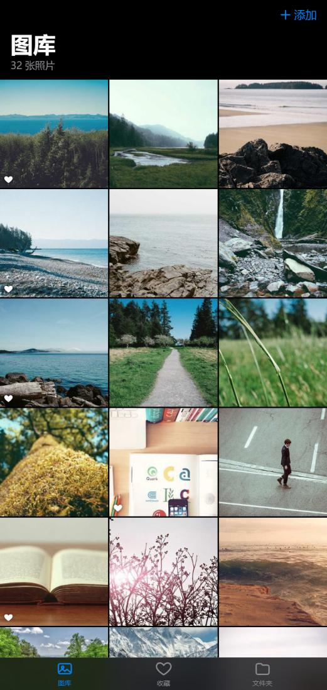
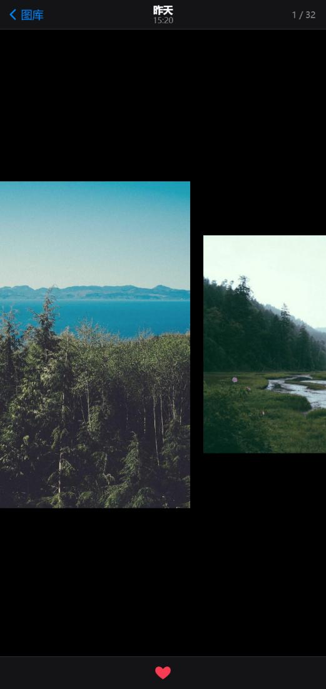
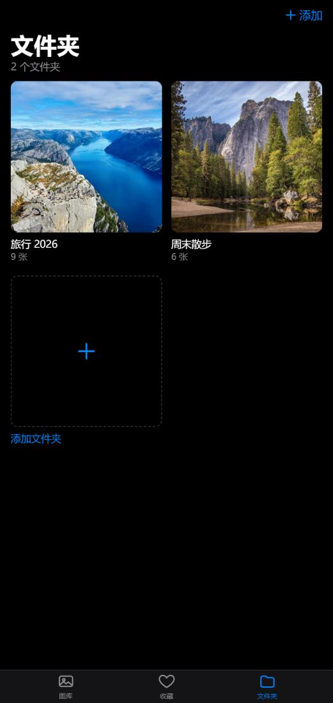
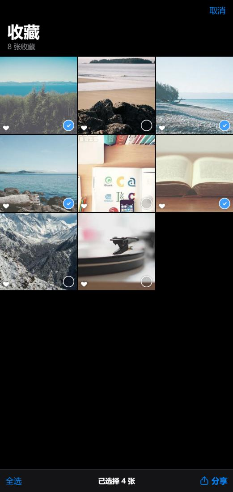
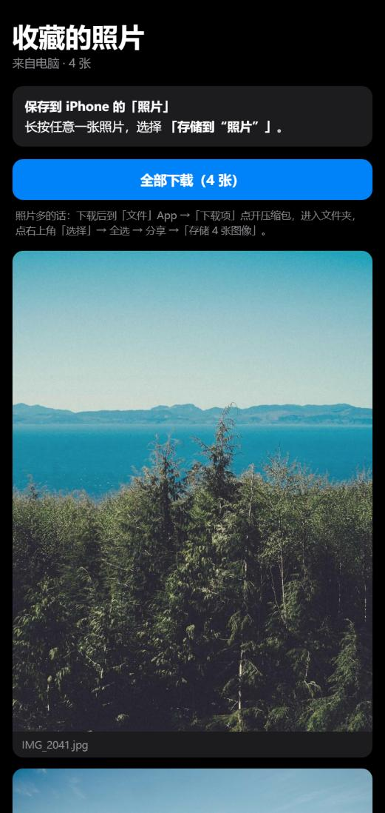

# Photos' heart ❤

在 Windows 电脑上挑照片的小 app：像在 iPhone「照片」里一样左右翻看，喜欢的点 ♡ 收藏，最后用手机扫个码，就能把挑好的照片存进 iPhone。

[English](#english)

<table>
  <tr>
    <td align="center"> 图库</td>
    <td align="center"> 像 iPhone 一样滑动翻页</td>
    <td align="center"> 点 ♡ 收藏</td>
  </tr>
</table>

## 项目由来

给宝宝拍完百天照，留下了一大堆照片，我要帮老婆从里面挑出最满意的几张。

结果发现 Windows 自带的「照片」app 没有好用的打心收藏，没法一边翻一边标记喜欢的照片；挑好以后想传到 iPhone 上也很麻烦。

所以就做了这个 app：在电脑上像在 iPhone 上一样翻看照片，喜欢的点个 ♡，然后勾选想要的几张，用 iPhone 相机扫一下二维码，照片就能存进手机里。

## 功能

- **iPhone 风格的翻看体验**：左右滑动翻页带弹性回弹，照片之间有间隙；点开时照片从缩略图放大，往下拖就缩回原位；支持双击和双指放大。
- **♡ 收藏**：看照片时点爱心收藏，所有收藏集中在「收藏」页。
- **直接浏览电脑上的文件夹**：选一个文件夹，里面的图片（包括子文件夹）会自动显示；往文件夹里加了新照片，下次打开就能看到。照片不会被复制。
- **分享到 iPhone**：在收藏里勾选想要的照片，iPhone 扫码后长按即可存进「照片」，也可以一键下载全部。不需要数据线，也不需要登录任何账号。
- **跟随系统语言**：支持简体中文、繁體中文和英文，日期、时间按系统格式显示。

## 截图

<table>
  <tr>
    <td align="center"> 添加电脑上的文件夹</td>
    <td align="center"> 文件夹里的照片</td>
    <td align="center"> 勾选要分享的收藏</td>
  </tr>
  <tr>
    <td align="center"> 用 iPhone 扫码</td>
    <td align="center"> iPhone 上长按保存</td>
    <td></td>
  </tr>
</table>

## 怎么用

### 准备

- 一台 Windows 电脑，装好 **Chrome** 或 **Edge** 浏览器。
- 想分享到 iPhone 的话，还需要安装 [Node.js](https://nodejs.org)（下载 LTS 版本，一路下一步即可）。

### 1. 打开 app

- 只看照片、打心：直接双击 `index.html`。
- 要分享到 iPhone：双击 `启动照片.cmd`。它会打开同一个 app，并在后台开一个小服务器（就是那个黑色窗口），分享期间别关它。

> 第一次运行 `启动照片.cmd` 时，Windows 防火墙可能会询问是否允许 Node.js 访问网络，请选「允许」，否则 iPhone 连不上电脑。

### 2. 添加照片

- 底部点「文件夹」→「添加文件夹」，选择存放照片的文件夹（比如相机导出的文件夹）。
- 也可以在「图库」点右上角「添加」→「选择照片」，或者直接把照片拖进窗口。
- 下次打开 app 时，浏览器可能会再确认一次是否允许读取文件夹，点一下文件夹封面就行。

### 3. 翻看和打心

- 点缩略图打开照片，左右滑动（或按 ← →、滚动鼠标滚轮）翻页。
- 点底部的 ♡ 收藏，再点一次取消。键盘上按 `F` 也可以。
- 往下拖照片或按 `Esc` 返回网格。单击照片可以隐藏工具栏，双击放大。

### 4. 分享到 iPhone

1. 确认 `启动照片.cmd` 的黑色窗口开着。
2. 进入「收藏」，点右上角「分享到 iPhone」，勾选想要的照片（或点「全选」），再点「分享」。
3. iPhone 连上和电脑**同一个 Wi-Fi**，用相机扫屏幕上的二维码，打开链接。
4. 长按照片 →「存储到“照片”」。照片多的话点「全部下载」，再到「文件」App 里解压，全选后点「存储图像」。

## 常见问题

**收藏记录保存在哪里？**
保存在浏览器里（localStorage），不会上传到任何地方。清除浏览器数据、换浏览器都会让收藏重新开始。

**iPhone 扫码后打不开？**
确认手机和电脑连的是同一个 Wi-Fi，电脑上的黑色窗口还开着，并且 Windows 防火墙已允许 Node.js。公司或公共 Wi-Fi 有时会禁止设备之间互相访问。

**Safari 或 Firefox 能用吗？**
可以浏览和打心，但这两个浏览器不能直接读取文件夹：选择文件夹时会把图片复制进浏览器保存，之后往文件夹里新加的照片不会自动出现。推荐使用 Chrome 或 Edge。

**照片会被上传吗？**
不会。照片只在你的电脑上，分享时也只是通过家里的 Wi-Fi 直接传给 iPhone。只有还没添加自己的照片时显示的示例图片，是从 [Lorem Picsum](https://picsum.photos) 网站加载的。

## 文件说明

| 文件 | 作用 |
| --- | --- |
| `index.html` | app 本体，所有界面和功能都在这一个文件里 |
| `server.js` | 分享到 iPhone 用的小服务器（不需要安装额外的依赖） |
| `启动照片.cmd` | 双击运行服务器并打开 app |
| `docs/screenshots/` | 说明里用到的截图 |

---

## English

**Photos' heart ❤** is a small photo picker for Windows. Browse photos with iPhone-style swiping, tap ♡ to favorite the ones you like, then scan a QR code with your iPhone to save the chosen photos to it.

### The story

After our baby's 100-day photo shoot, I had a huge pile of photos to go through with my wife. The built-in Windows Photos app has no good way to heart favorites while flipping through, and getting the picks onto an iPhone was a hassle. So I built this.

### Features

- iPhone-style viewer: swipe between photos with spring physics, open from the thumbnail, swipe down to close, double-tap or pinch to zoom.
- Tap ♡ to favorite; all favorites are collected in the Favorites tab.
- Browse folders on your computer directly (subfolders included). New photos show up the next time you open the app. Nothing is copied.
- Share to iPhone over Wi-Fi: pick photos, scan the QR code, then touch and hold to Save to Photos, or download them all. No cable, no account.
- Follows your system language (English, Simplified Chinese, Traditional Chinese).

### How to use

1. Double-click `index.html` to browse and favorite (Chrome or Edge recommended).
2. To share to iPhone, install [Node.js](https://nodejs.org) and double-click `启动照片.cmd` ("start photos"). Keep the black window open, and allow Node.js through Windows Firewall when asked.
3. Add photos: **Folders → Add Folder**, or **Library → Add → Choose Photos**, or drag photos into the window.
4. Open a photo, swipe to browse, tap ♡ to favorite.
5. In **Favorites**, tap **Share to iPhone**, select photos, tap **Share**, and scan the QR code with your iPhone camera (same Wi-Fi). Touch and hold a photo → **Save to Photos**.

Favorites are stored in your browser only. Photos never leave your computer and home network. The sample photos shown before you add your own come from [Lorem Picsum](https://picsum.photos).
